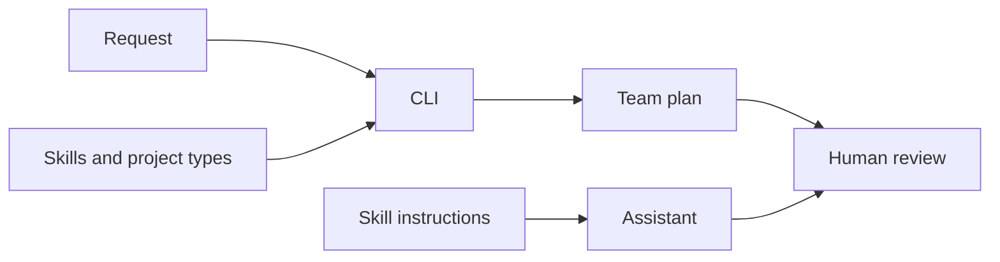

# Apex Elite Framework

[Português (Brasil)](README.pt-BR.md) · [Quick start](docs/QUICK_START.md) · [Installation](docs/INSTALLATION.md) · [Skill directory](#skill-directory) · [Architecture](#architecture) · [Contribute](#contribute)


Turn a request into a project plan with responsibilities, evidence requirements and a stopping point. Use the Markdown skills in a conversation, or run the local Python CLI to generate a repeatable plan. The CLI works offline after installation and requires no API key.

[](LICENSE) · [Source version](VERSION) · [CI runs](https://github.com/matheusflorindo32/apex-elite-framework/actions/workflows/quality.yml)

This branch prepares a release candidate for human review. The assistant's answer depends on its model and the context you supply. The CLI generates plans and checks the framework's files. People carry out and verify the planned work.

[Host compatibility](docs/COMPATIBILITY.md) · [Downloads and checksums](docs/DISTRIBUTION.md) · [Candidate review and rollback](docs/RELEASE_CANDIDATE.md) · [International benchmark](docs/quality/INTERNATIONAL_BENCHMARK.md)

## Start with your task

| You want to… | Start here |
| --- | --- |
| Try a first task in ChatGPT without installing software | [Three-step guide with a sample answer](docs/QUICK_START.md) |
| Critique a paper or prepare a research project | [Scientific review example](examples/scientific-review.md) · [Scientific checklist](checklists/scientific-qa.md) |
| Scope an app and review the plan | [Software example](examples/software-project.md) · [Developer installation](docs/INSTALLATION.md) |
| Plan an automation with human approval | [Automation example](examples/automation.md) |
| Prepare slides, layouts or illustrations | [Visual prompt kit](docs/VISUAL_PROMPT_KIT.md) |

## Skill directory

A skill is a set of written instructions. An alias is a short label you can use once the assistant has those instructions. Most source skills and CLI content are in Portuguese.

| Need | Skill | Need | Skill |
| --- | --- | --- | --- |
| Coordinate several projects | [@Commander](skills/commander/SKILL.md) | Plan one delivery | [@EPO](skills/elite-project-orchestrator/SKILL.md) |
| Evaluate methods | [@Scientific](skills/scientific/SKILL.md) | Organize sources | [@Research](skills/research/SKILL.md) |
| Edit a publication | [@Editorial](skills/editorial/SKILL.md) | Design a visual | [@Design](skills/design/SKILL.md) |
| Engineer software | [@Software](skills/software/SKILL.md) | Plan a workflow | [@Automation](skills/automation/SKILL.md) |
| Structure a business | [@Business](skills/business/SKILL.md) | Reach an audience | [@Marketing](skills/marketing/SKILL.md) |
| Check acceptance criteria | [@QA](skills/quality-assurance/SKILL.md) | | |

## Architecture



The CLI reads the catalog and project type to select a team, phases and review criteria. A conversational assistant reads the instructions you provide. Specify a project type explicitly for predictable routing. [Architecture](docs/ARCHITECTURE.md) · [Usage](docs/USAGE.md)

After installation, try the following in your checkout.

```bash
uv run aef skills list
uv run aef plan --type software --request "Plan an accessible reading diary"
uv run aef checklist --type software
```

[Skill catalog](docs/SKILLS.md) · [Research guide](docs/RESEARCHERS.md) · [Eight walkthroughs](examples/WALKTHROUGHS.md) · [Ecosystem](docs/ECOSYSTEM.md)

## ChatGPT and Codex

For ChatGPT, attach the [knowledge file](bundles/APEX_CHATGPT_KNOWLEDGE.md). For a custom GPT, copy the [instructions](bundles/APEX_INSTRUCTIONS.md) into its Instructions field and add the knowledge file to Knowledge. For Codex, follow the [setup guide](bundles/APEX_CODEX_SETUP.md). Native skill discovery depends on the host and installation. Use only material you may share with that service.

## Contribute

Report reproducible problems through [Issues](https://github.com/matheusflorindo32/apex-elite-framework/issues). Report sensitive findings through the [security policy](SECURITY.md). The release roadmap is to review the candidate, validate onboarding with real beginners and record host-specific compatibility evidence. [Contributing](CONTRIBUTING.md) · [Creating skills](docs/CREATING_SKILLS.md) · [Version policy](docs/VERSIONING.md) · [Change history](CHANGELOG.md)

Created by Matheus Florindo. Distributed under the [Apache License 2.0](LICENSE).
