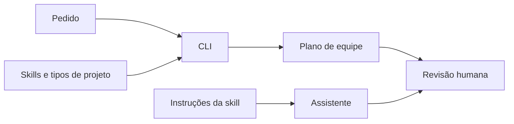

# Apex Elite Framework

[English](README.md) · [Início rápido](docs/QUICK_START.pt-BR.md) · [Instalação](docs/INSTALLATION.md) · [Especialidades](#especialidades) · [Arquitetura](#arquitetura) · [Contribuição](#contribuição)


Transforme um pedido em um plano com responsáveis, evidências necessárias e condições de parada. Use as skills em Markdown numa conversa ou gere um plano reproduzível com a ferramenta local em Python. Depois da instalação, a CLI funciona offline e dispensa chave de API.

[](LICENSE) · [Versão do código](VERSION) · [Execuções de CI](https://github.com/matheusflorindo32/apex-elite-framework/actions/workflows/quality.yml)

Esta branch prepara uma candidata a lançamento para revisão humana. Em uma conversa, as respostas dependem do modelo e do contexto fornecido. A CLI gera planos e verifica os arquivos do framework. Cabe às pessoas executar o trabalho planejado e conferir os resultados.

## Escolha seu ponto de partida

| Objetivo | Recurso |
| --- | --- |
| Fazer o primeiro teste no ChatGPT sem instalar programas | [Três passos com exemplo de resposta](docs/QUICK_START.pt-BR.md) |
| Revisar um artigo ou preparar uma pesquisa | [Exemplo científico](examples/scientific-review.md) · [Checklist de revisão](checklists/scientific-qa.md) |
| Planejar um aplicativo | [Exemplo de software](examples/software-project.md) · [Instalação para desenvolvimento](docs/INSTALLATION.md) |
| Organizar uma automação com aprovação humana | [Exemplo de automação](examples/automation.md) |
| Criar slides, diagramas ou ilustrações | [Kit prático de referências visuais](docs/VISUAL_PROMPT_KIT.md) |

## Especialidades

Uma skill reúne instruções escritas. Um alias é uma forma curta de indicar a especialidade depois de fornecer as instruções ao assistente.

| Necessidade | Skill | Necessidade | Skill |
| --- | --- | --- | --- |
| Coordenar vários projetos | [@Commander](skills/commander/SKILL.md) | Planejar uma entrega | [@EPO](skills/elite-project-orchestrator/SKILL.md) |
| Avaliar métodos | [@Scientific](skills/scientific/SKILL.md) | Organizar fontes | [@Research](skills/research/SKILL.md) |
| Editar uma publicação | [@Editorial](skills/editorial/SKILL.md) | Criar material visual | [@Design](skills/design/SKILL.md) |
| Projetar software | [@Software](skills/software/SKILL.md) | Estruturar um fluxo | [@Automation](skills/automation/SKILL.md) |
| Estruturar um negócio | [@Business](skills/business/SKILL.md) | Comunicar com o público | [@Marketing](skills/marketing/SKILL.md) |
| Verificar critérios de aceite | [@QA](skills/quality-assurance/SKILL.md) | | |

## Arquitetura



A CLI consulta o catálogo e o tipo de projeto para selecionar equipe, fases e critérios de revisão. Na conversa, o assistente lê as instruções fornecidas. Informe o tipo de projeto para obter roteamento previsível. [Arquitetura](docs/ARCHITECTURE.md) · [Uso](docs/USAGE.md)

Depois da instalação, experimente na pasta do projeto.

```bash
uv run aef skills list
uv run aef plan --type software --request "Planejar um diário de leitura acessível"
uv run aef checklist --type software
```

[Catálogo](docs/SKILLS.md) · [Guia de pesquisa](docs/RESEARCHERS.md) · [Oito demonstrações](examples/WALKTHROUGHS.md) · [Ecossistema](docs/ECOSYSTEM.md)

## ChatGPT e Codex

No ChatGPT, anexe o [arquivo de conhecimento](bundles/APEX_CHATGPT_KNOWLEDGE.md). Para um GPT personalizado, copie as [instruções](bundles/APEX_INSTRUCTIONS.md) para o campo Instructions e adicione o arquivo de conhecimento em Knowledge. No Codex, consulte o [guia de configuração](bundles/APEX_CODEX_SETUP.md). A descoberta de skills nativas depende da plataforma e da instalação. Use somente materiais que você possa compartilhar com o serviço.

## Contribuição

Relate problemas reproduzíveis em [Issues](https://github.com/matheusflorindo32/apex-elite-framework/issues). Encaminhe falhas sensíveis pela [política de segurança](SECURITY.md). As próximas etapas são revisar a candidata, observar iniciantes no primeiro uso e registrar evidências por plataforma. [Como contribuir](CONTRIBUTING.md) · [Como criar skills](docs/CREATING_SKILLS.md) · [Versionamento](docs/VERSIONING.md) · [Histórico](CHANGELOG.md)

Criado por Matheus Florindo. Distribuído sob a [licença Apache 2.0](LICENSE).
